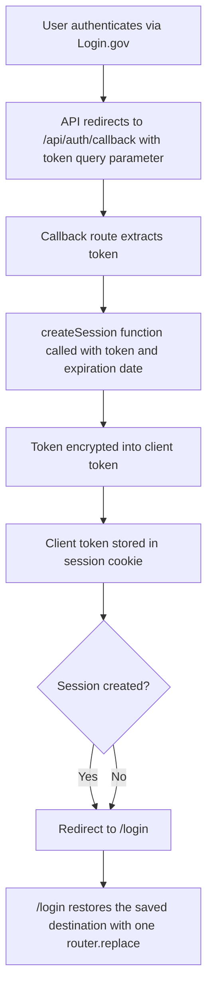
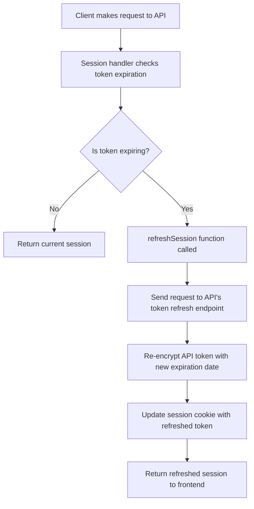

# Authentication

This document explains how the Simpler Grants Next JS frontend application handles token creation, token checks, and expiration refreshes to manage user authentication.

## Token Creation

Tokens are created at the end of the login process, which is initiated when a user authenticates against Login.gov via the Simpler API. The API / Login.gov process is covered in the API documentation here(https://github.com/HHS/simpler-grants-gov/blob/main/documentation/api/authentication.md).

Once the flow takes you into the frontend code, the token:

- is extracted from the query param in the callback route
  - After successful authentication, the API redirects the user to the `/api/auth/callback` route with a `token` query parameter.
  - The `GET` handler in `callback/route.ts` processes this request.

- is encrypted into a client cookie
  - the token from the query param is encrypted with a new expiration date and stored in a `session` cookie

- sent down to the client on redirect
  - If the token is valid and the session is successfully created, the user is redirected to the `/login` page.
  - If the token is missing or an error occurs during session creation, the user is also redirected to `/login`, which returns them to their saved page in the signed-out state.
  - If Login.gov reports that PIV is required (`login_piv_required_error=true`), the user is redirected to `/login?pivError=true`.

## Return Navigation

The frontend returns users to the page where they chose Sign in or Create account.

1. `storeCurrentPage()` saves the current pathname + query (for example `/search?query=test&utm_source=grants.gov`) to `sessionStorage["login-redirect"]` when the user explicitly starts authentication. This is the only return-state mechanism; `/api/auth/login` does not carry a return destination.
2. `/api/auth/login` hands the user off to Login.gov.
3. Login.gov returns to `/api/auth/callback`, which always redirects to `/login` (or `/login?pivError=true`). The callback never reads or clears the saved destination and never logs the token.
4. `/login` reads `login-redirect`, validates it, keeps the safe destination in a local variable, clears `login-redirect`, then calls `router.replace(destination)` exactly once. Repeated effect runs, such as under React Strict Mode, do not navigate again.

A saved destination is used only if it is a root-relative Simpler path: it must begin with `/`, must not begin with `//`, must not contain backslashes, whitespace, or control characters, must be well formed, and must not be (or be under) `/login`, `/logout`, `/maintenance`, `/error`, `/api`, or `/dev`. Invalid values are not repaired; they fall back to `/`.

If the user leaves Login.gov with the browser Back button, they return to the previous Simpler page. Authentication is not restarted automatically, and `login-redirect` stays in that tab until `/login` uses it or the user starts authentication again, which replaces it.

The validator and its blocked prefixes live in `src/utils/userUtils.ts` and `src/constants/auth.ts`. The `/logout` page uses the same `PostAuthRedirect` component and destination rules.

## Token Checks

### How and When Tokens Are Checked

Tokens are validated during user interactions with the application. Specifically:

- Routine Session Retrieval
  - whenever the client makes a call to the Next API's /session route, the token provided from the session cookie will be validated
  - these calls can be traced from the [useUser `getUserSession` function](https://github.com/HHS/simpler-grants-gov/blob/7eab597355d4fc0d1e3e32a1a82d1987cc9a7df8/frontend/src/services/auth/UserProvider.tsx#L21)
  - generally, this is done whenever a user logs in or out

- Expiration Checks
  - expiration checks are run on each route change and API request within the client application. See:
    - [useClientFetch](https://github.com/HHS/simpler-grants-gov/blob/7eab597355d4fc0d1e3e32a1a82d1987cc9a7df8/frontend/src/hooks/useClientFetch.ts#L21)
    - [RouteChangeWatcher](https://github.com/HHS/simpler-grants-gov/blob/main/frontend/src/components/core/header/RouteChangeWatcher.tsx)
  - checks are also run whenever the session is retrieved from the API as described above

### What Happens If a Token Check Fails

If a token is invalid or expired the user is logged out of the system, and shown a message that they have been logged out. In most cases this requires an automated page refresh in order to fully log the user out of the UI.

The logged out message is controlled by [logic in the Header component](https://github.com/HHS/simpler-grants-gov/blob/7eab597355d4fc0d1e3e32a1a82d1987cc9a7df8/frontend/src/components/Header.tsx#L258).

---

## Token Expiration Refreshes

### How Tokens Are Refreshed

The application refreshes tokens to extend the user's session without requiring them to log in again. This process involves:

1. **Client Request**
   - Whenever the client makes a request to the NextJS api using the `clientFetch` function returned by the `useClientFetch` hook, the client will make a call to the /session endpoint

1. **Expiration Detection**:
   - When the session handler is called, it checks if the session is expiring using the `isExpiring` function. Currently `isExpiring` is set to consider any token that is less than 10 minutes from expiring to be eligible for refresh

1. **Token Refresh Process**:
   - The `refreshSession` function in `session.ts` is called to refresh the token.
   - This function:
     - Sends a request to the Simpler API's token refresh endpoint (`postTokenRefresh`) to update the expiration on the server side.
     - Re-encrypts the existing API token with a new expiration date using the `createAndReturnSession` function.
     - Updates the `session` cookie with the refreshed token.

1. **Frontend Behavior**:
   - The refreshed session is returned to the frontend, ensuring the user remains authenticated without interruption.

## Session Expiration

### Default behavior

A session expires after 15 minutes without activity. Clicks, key presses, route changes and client requests within the last 10 minutes of a session refresh it for another 15 minutes (see [Token Expiration Refreshes](#token-expiration-refreshes)). The frontend session and the API token are refreshed together, so they always expire at the same time.

When a session expires:

- The `session` cookie stops being sent by the browser, and its signed `exp` claim is checked on every read. An expired cookie is treated as no session, so server-rendered pages, Next API routes and API calls made on the user's behalf all behave as signed out. The API rejects the expired token on its own as well.
- The UI switches to the signed-out state and shows the "You've been logged out. Please sign in again." message from the Header. Without the feature flag below, this happens on the user's next click, key press, route change or client request.
- `session_expired` is logged once (see [Observability](#observability)).

### Expiration alerts (`enableSessionExpirationAlerts`)

With the `enableSessionExpirationAlerts` feature flag on:

1. **Warning before expiry.** A "Your session is about to expire" dialog opens 2 minutes before the session expires (or halfway through, for sessions shorter than 4 minutes). It shows a live countdown and two actions:
   - **Stay signed in** (also the X button, Escape, or clicking outside the dialog) refreshes the session and closes the dialog.
   - **Sign out** signs the user out through the normal logout flow and returns them to the same page afterwards.

   The dialog also closes on its own if the session is refreshed by activity in this or another tab.

2. **Automatic logout at expiry.** If the user does nothing, they are logged out at the expiry time with no action needed. They stay on the current URL, the page is refreshed in the signed-out state (auth-gated pages show the sign-in message, and private data is no longer shown), and the "You've been logged out" message appears.

> **Production impact:** `enableSessionExpirationAlerts` defaults to off, so production behavior does not change until the flag is turned on. Turn it on per browser with `?_ff=enableSessionExpirationAlerts:true` or `/dev/feature-flags`. Rolling it out to everyone means changing the default or adding a `FEATURE_` environment variable, which needs Product and Design sign-off on the dialog copy.

### Shorter sessions for QA and E2E testing (lower environments only)

> **Lower environments only.** The override below only works when `ENVIRONMENT` is `local`, `dev` or `staging`, in both the frontend and the API. Every other environment, including `prod` and `training`, ignores it, both when the session is created and every time it is read or refreshed. An override can only shorten a session (30 to 900 seconds), never make it longer than the 15 minute default.

To get a short session, start sign in from this URL instead of the Sign in button:

```
/api/auth/login?session_duration_seconds=60
```

- `/api/auth/login` stores the requested duration in a short-lived, single-use `session_duration_override` cookie so it survives the Login.gov round trip.
- `/api/auth/callback` reads and deletes that cookie. It first shortens the API token to the same duration (`POST /v1/users/token/refresh` with `session_duration_seconds`), then sets the frontend session to expire at the same time and writes the duration into the signed `session` cookie as `session_duration_seconds`. If the API cannot be updated, sign in continues with the default 15 minute session and a `session_duration_override_failed` warning is logged, so the two never get out of sync.
- Refreshes send the same duration to the API, so the session behaves as it does in production, just faster: activity keeps it alive, and inactivity for `session_duration_seconds` ends it in both the frontend and the API.
- Values outside 30-900, non-integers, or any value in a non-allowed environment are ignored with a `session_duration_override_ignored` warning, and sign in continues with the default 15 minutes.

E2E tests sign in with a spoofed session cookie instead of Login.gov. Pass the same duration to the helper, which also passes it to `POST /v1/internal/e2e-token` so the API token matches:

```ts
await authenticateE2eUser(page, context, isMobile, "primaryOrgAdmin", {
  sessionDurationSeconds: 60,
});
```

To test alerts in E2E, also turn the flag on, for example by visiting a page with `?_ff=enableSessionExpirationAlerts:true` first.

`AUTH_EXPIRATION_TIME` is separate. It is an environment variable for local development only (see [environments](./environments.md)), and the URL override takes precedence over it.

### QA validation

In dev or staging:

1. Open any page with `?_ff=enableSessionExpirationAlerts:true` to turn on expiration alerts for your browser.
2. Go to `/api/auth/login?session_duration_seconds=60` and sign in.
3. Open an authenticated page, for example `/workspace`, and do nothing.
4. After about 30 seconds, expected: the "Your session is about to expire" dialog opens with a countdown from 0:30.
5. Choose **Stay signed in**. Expected: the dialog closes and you stay signed in. It opens again about 30 seconds later.
6. This time do nothing. Expected: when the countdown ends, you stay on the same URL, the dialog closes, the "You've been logged out" message appears, the header shows Sign in, and the workspace shows the sign-in message.
7. Reload the page or go to another protected page. Expected: it is still signed out.
8. Sign in again with the normal Sign in button. Expected: access returns, and the session uses the default 15 minutes.
9. Repeat steps 2-4 and choose **Sign out**. Expected: you are signed out and returned to the same page.
10. Repeat steps 2-3 but click somewhere on the page every ~20 seconds. Expected: the dialog never opens and you stay signed in.
11. With the flag off, repeat steps 2-3. Expected: no dialog. Nothing changes until you click or navigate after 60 seconds, then the logged-out message appears.
12. In prod (or training), `/api/auth/login?session_duration_seconds=60` must give a normal 15 minute session.

## Observability

Authentication lifecycle events go through the existing logging paths. Server-side events are logged with the Pino logger (`simplerLogger`). Client-side events are sent with `postUserEvent`, and `/api/events` logs them with the `correlation_id` from the cookie. Their `properties` are logged as top-level attributes, so fields such as `reason` are directly queryable. Properties named `level`, `msg`, `time`, `event` or `correlation_id` are ignored.

| Event                                 | Source | Trigger                                                                                     | Additional fields                        |
| ------------------------------------- | ------ | ------------------------------------------------------------------------------------------- | ---------------------------------------- |
| `authentication_initiated`            | Client | User starts Sign in or Create account                                                       | `pivRequired`                            |
| `callback_received`                   | Server | Login.gov callback reaches the frontend                                                     | `tokenPresent`, `pivRequiredError`       |
| `session_created`                     | Server | Frontend session creation succeeds                                                          | `sessionDurationSeconds` (override only) |
| `session_creation_failed`             | Server | Frontend session creation fails                                                             | `err`                                    |
| `destination_restored`                | Client | `/login` restores a valid saved destination                                                 | —                                        |
| `destination_rejected`                | Client | `/login` falls back instead of using the saved destination                                  | `reason`                                 |
| `session_expired`                     | Client | A previously signed-in session expires                                                      | —                                        |
| `logout`                              | Server | Explicit logout completes and the frontend session is deleted                               | `apiResult`                              |
| `authentication_request_failed`       | Server | Authentication infrastructure/configuration request fails                                   | `authRequest`, `reason` or `status`      |
| `session_duration_override_requested` | Server | Lower env sign in starts with a valid `session_duration_seconds`                            | `sessionDurationSeconds`                 |
| `session_duration_override_ignored`   | Server | `session_duration_seconds` is invalid or the environment does not allow it (logged at warn) | `environment`                            |
| `session_duration_override_failed`    | Server | The API token could not be shortened, so the default duration is used (logged at warn)      | `status`                                 |

Notes:

- `logout` records the completion of sign out, not the click. `apiResult` is `success` or `error` as reported by the API logout, when present. Session expiry is never counted as a logout.
- `session_expired` is not logged for anonymous visitors, failed session requests, or a signed-out response before the expiry time (for example after signing out in another tab).
- `session_creation_failed` and `authentication_request_failed` are logged at error level.
- Authentication lifecycle events never include tokens, session secrets, or saved/rejected destination URLs. The `token` query parameter, which carries the Login.gov token, is also redacted from request-log URLs on any path.

### Destination outcomes

Destination events are only logged on `/login`; the `/logout` page does not log them. `destination_rejected` has a `reason`:

- `missing`: there was no saved destination.
- `invalid`: the saved destination failed validation.

Lifecycle events never contain the saved or rejected URL.

### Authentication request failures

`authentication_request_failed` covers:

- `authRequest: "login"`, `reason: "login_url_not_configured"`: `AUTH_LOGIN_URL` is missing.
- `authRequest: "logout"`, `reason: "logout_url_not_configured"`: `AUTH_LOGOUT_URL` is missing.
- `authRequest: "logout_callback"`: the session could not be deleted at the end of sign out.
- `authRequest: "session_refresh"`, `status`: refreshing an expiring token failed with anything other than a 401 or 403. Network errors and API Gateway errors are included (API Gateway errors report a status of `0`).

Expected outcomes are not logged as failures. These include a callback without a token, PIV required, signing out without a session, the API rejecting a token on refresh, and a rejected destination.

### Correlation IDs

Server-side and client-side events both carry `correlation_id`, from the same `correlation_id` cookie. See [Correlation ID and request URLs](./analytics.md#correlation-id-and-request-urls) for the request log queries.

The correlation ID only identifies Simpler-side requests. It is not passed through Login.gov, and it is not guaranteed to be present on `/api/auth/callback` (for example when the cookie has expired or is new). Sign out deletes it after `logout` is logged. Treat the segments before and after Login.gov as separate unless their correlation IDs match.

## Diagrams

### Token Creation



### Token Refresh


