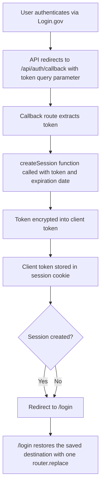
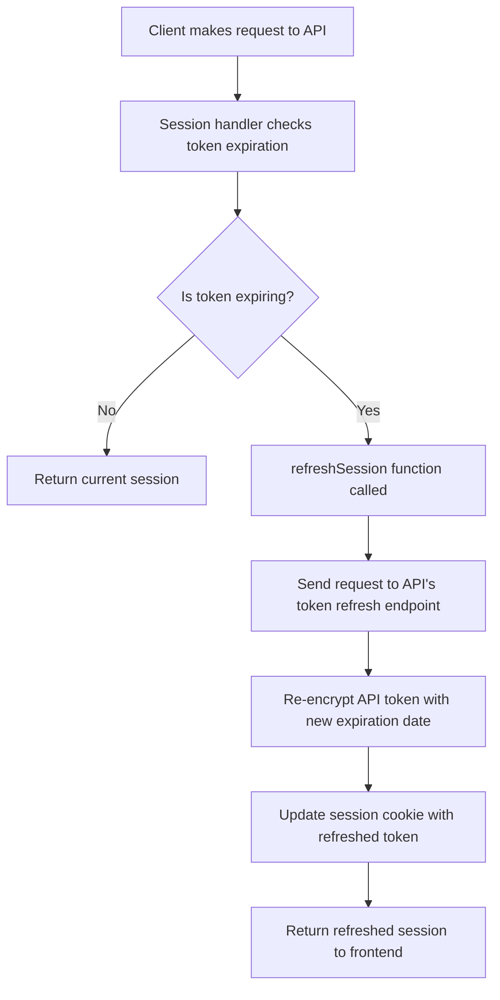

# Authentication

This document explains how the Simpler Grants Next JS frontend application handles token creation, token checks, and expiration refreshes to manage user authentication.

## Token Creation

Tokens are created at the end of the login process, which is initiated when a user authenticates against Login.gov via the Simpler API. The API / Login.gov process is covered in the API documentation here(https://github.com/HHS/simpler-grants-gov/blob/main/documentation/api/authentication.md).

Once the flow takes you into the frontend code, the token:

- is extracted from the query param in the callback route
  - After successful authentication, the API redirects the user to the `/api/auth/callback` route with a `token` query parameter.
  - The `GET` handler in `callback/route.ts` processes this request.

- is encrypted into a client cookie
  - the token from the query param is encrypted with a new expiration date and stored in a `session` cookie

- sent down to the client on redirect
  - If the token is valid and the session is successfully created, the user is redirected to the `/login` page.
  - If the token is missing or an error occurs during session creation, the user is also redirected to `/login`, which returns them to their saved page in the signed-out state.
  - If Login.gov reports that PIV is required (`login_piv_required_error=true`), the user is redirected to `/login?pivError=true`.

## Return Navigation

The frontend returns users to the page where they chose Sign in or Create account.

1. `storeCurrentPage()` saves the current pathname + query (for example `/search?query=test&utm_source=grants.gov`) to `sessionStorage["login-redirect"]` when the user explicitly starts authentication. This is the only return-state mechanism; `/api/auth/login` does not carry a return destination.
2. `/api/auth/login` hands the user off to Login.gov.
3. Login.gov returns to `/api/auth/callback`, which always redirects to `/login` (or `/login?pivError=true`). The callback never reads or clears the saved destination and never logs the token.
4. `/login` reads `login-redirect`, validates it, keeps the safe destination in a local variable, clears `login-redirect`, then calls `router.replace(destination)` exactly once. Repeated effect runs, such as under React Strict Mode, do not navigate again.

A saved destination is used only if it is a root-relative Simpler path: it must begin with `/`, must not begin with `//`, must not contain backslashes, whitespace, or control characters, must be well formed, and must not be (or be under) `/login`, `/logout`, `/maintenance`, `/unauthenticated`, `/error`, `/api`, or `/dev`. Invalid values are not repaired; they fall back to `/`.

If the user leaves Login.gov with the browser Back button, they return to the previous Simpler page. Authentication is not restarted automatically, and `login-redirect` stays in that tab until `/login` uses it or the user starts authentication again, which replaces it.

The validator and its blocked prefixes live in `src/utils/userUtils.ts` and `src/constants/auth.ts`. The `/logout` page uses the same `PostAuthRedirect` component and destination rules.

## Token Checks

### How and When Tokens Are Checked

Tokens are validated during user interactions with the application. Specifically:

- Routine Session Retrieval
  - whenever the client makes a call to the Next API's /session route, the token provided from the session cookie will be validated
  - these calls can be traced from the [useUser `getUserSession` function](https://github.com/HHS/simpler-grants-gov/blob/7eab597355d4fc0d1e3e32a1a82d1987cc9a7df8/frontend/src/services/auth/UserProvider.tsx#L21)
  - generally, this is done whenever a user logs in or out

- Expiration Checks
  - expiration checks are run on each route change and API request within the client application. See:
    - [useClientFetch](https://github.com/HHS/simpler-grants-gov/blob/7eab597355d4fc0d1e3e32a1a82d1987cc9a7df8/frontend/src/hooks/useClientFetch.ts#L21)
    - [RouteChangeWatcher](https://github.com/HHS/simpler-grants-gov/blob/main/frontend/src/components/core/header/RouteChangeWatcher.tsx)
  - checks are also run whenever the session is retrieved from the API as described above

### What Happens If a Token Check Fails

If a token is invalid or expired the user is logged out of the system, and shown a message that they have been logged out. In most cases this requires an automated page refresh in order to fully log the user out of the UI.

The logged out message is controlled by [logic in the Header component](https://github.com/HHS/simpler-grants-gov/blob/7eab597355d4fc0d1e3e32a1a82d1987cc9a7df8/frontend/src/components/Header.tsx#L258).

---

## Token Expiration Refreshes

### How Tokens Are Refreshed

The application refreshes tokens to extend the user's session without requiring them to log in again. This process involves:

1. **Client Request**
   - Whenever the client makes a request to the NextJS api using the `clientFetch` function returned by the `useClientFetch` hook, the client will make a call to the /session endpoint

1. **Expiration Detection**:
   - When the session handler is called, it checks if the session is expiring using the `isExpiring` function. Currently `isExpiring` is set to consider any token that is less than 10 minutes from expiring to be eligible for refresh

1. **Token Refresh Process**:
   - The `refreshSession` function in `session.ts` is called to refresh the token.
   - This function:
     - Sends a request to the Simpler API's token refresh endpoint (`postTokenRefresh`) to update the expiration on the server side.
     - Re-encrypts the existing API token with a new expiration date using the `createAndReturnSession` function.
     - Updates the `session` cookie with the refreshed token.

1. **Frontend Behavior**:
   - The refreshed session is returned to the frontend, ensuring the user remains authenticated without interruption.

## Observability

Authentication lifecycle events go through the existing logging paths. Server-side events are logged with the Pino logger (`simplerLogger`). Client-side events are sent with `postUserEvent`, and `/api/events` logs them with the `correlationId` from the cookie.

| Event                           | Logged from                           | When                                                                                                  | Properties                                                                       |
| ------------------------------- | ------------------------------------- | ----------------------------------------------------------------------------------------------------- | -------------------------------------------------------------------------------- |
| `authentication_initiated`      | client: `LoginLink`, Header "Sign in" | the user clicks Sign in / Create account                                                              | `pivRequired` (boolean)                                                          |
| `callback_received`             | server: `/api/auth/callback`          | every callback request                                                                                | `tokenPresent`, `pivRequiredError` (booleans)                                    |
| `session_created`               | server: `/api/auth/callback`          | the `session` cookie was set                                                                          | none                                                                             |
| `session_creation_failed`       | server: `/api/auth/callback`          | `createSession` threw (logged at error level)                                                         | `err`                                                                            |
| `destination_restored`          | client: `/login` (`PostAuthRedirect`) | a valid saved destination is used                                                                     | none                                                                             |
| `destination_rejected`          | client: `/login` (`PostAuthRedirect`) | `/` is used instead of a saved destination                                                            | `reason`: `missing` (nothing saved) or `invalid` (saved value failed validation) |
| `session_expired`               | client: `UserProvider`                | a signed-in user is found signed out after their session expiry time                                  | none                                                                             |
| `logout`                        | server: `/api/auth/logout-callback`   | the frontend session was deleted at the end of an explicit sign out                                   | `apiResult`: `success` or `error`, as reported by the API logout, when present   |
| `authentication_request_failed` | server                                | an authentication request failed for a configuration or infrastructure reason (logged at error level) | `authRequest`, plus `reason` or `status`                                         |

`authentication_request_failed` covers:

- `authRequest: "login"`, `reason: "login_url_not_configured"`: `AUTH_LOGIN_URL` is missing.
- `authRequest: "logout"`, `reason: "logout_url_not_configured"`: `AUTH_LOGOUT_URL` is missing.
- `authRequest: "logout_callback"`: the session could not be deleted at the end of sign out.
- `authRequest: "session_refresh"`, `status`: refreshing an expiring token failed with anything other than a 401 or 403. Network errors and API Gateway errors are included (API Gateway errors report a status of `0`).

Expected outcomes are not logged as failures. These include a callback without a token, PIV required, signing out without a session, the API rejecting a token on refresh, and a rejected destination.

Notes:

- `logout` records the completion of sign out, not the click. Session expiry is never counted as a logout.
- `session_expired` is not logged for anonymous visitors, failed session requests, or a signed-out response before the expiry time (for example after signing out in another tab).
- Destination events never include the destination. They are only logged on `/login`; the `/logout` page does not log them.
- Tokens, session cookies, secrets and destinations are never logged. The `token` query parameter is redacted from request log URLs.

### Correlation IDs

Server-side events carry `correlation_id` and client-side events carry `correlationId`. Both come from the same `correlation_id` cookie, so a query should match either attribute. See [Correlation ID and request URLs](./analytics.md#correlation-id-and-request-urls) for the request log queries.

The correlation ID only identifies Simpler-side requests. It is not passed through Login.gov, and it is not guaranteed to be present on `/api/auth/callback` (for example when the cookie has expired or is new). Sign out deletes it after `logout` is logged. Treat the segments before and after Login.gov as separate unless their correlation IDs match.

## Diagrams

### Token Creation

### Token Refresh

