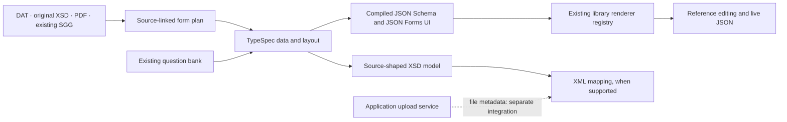
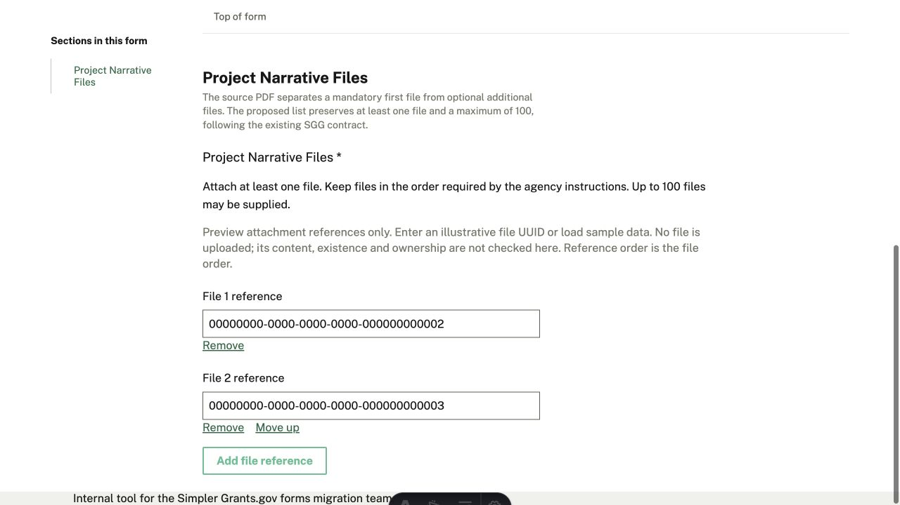
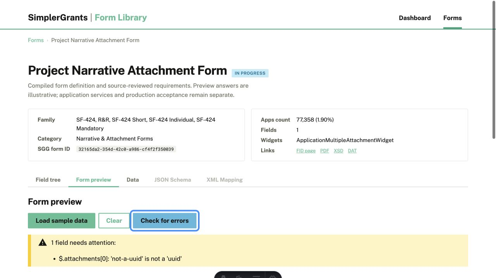

# Document forms: definitions, preview and delivery boundaries

Seven related forms now have TypeSpec definitions and layouts, compiled examples and
source-checked XSD models. They deliberately exercise different document contracts:

| Form                     | FID / edition | Answer contract                                            | Existing SGG equivalent                            |
| ------------------------ | ------------- | ---------------------------------------------------------- | -------------------------------------------------- |
| Attachments              | 540 / 1.2     | Fifteen optional, independently named `att1`…`att15` UUIDs | Yes                                                |
| Project Narrative        | 539 / 1.2     | Ordered `attachments` list, 1–100 UUIDs                    | Yes                                                |
| Budget Narrative         | 543 / 1.2     | Ordered `attachments` list, 1–100 UUIDs                    | Yes                                                |
| Other Attachments        | 542 / 1.2     | Ordered `attachments` list, 1–100 UUIDs                    | Yes                                                |
| Project Abstract         | 541 / 1.2     | One required `attachment` UUID                             | Yes                                                |
| Project Abstract Summary | 591 / 2.0     | Five text answers; four required                           | Yes                                                |
| ED Abstract              | 267 / 1.1     | One required `attachment` UUID                             | Not found in the pinned API form-registration scan |

The existing-code comparison is pinned to
[`48d93f88`](https://github.com/HHS/simpler-grants-gov/tree/48d93f882c63a711bdec4b16e3150d1293cdff43/api/src/form_schema/forms).
Code presence is not evidence of deployment. No equivalent was found for ED Abstract within
that scan; its UUID contract is a proposal consistent with the existing attachment type.

## Where each responsibility lives



Data models contain answers, not presentation groups. Layouts reference those models;
source-only XML wrappers stay in the XSD targets. A single `AttachmentSlot` template captures
the repeated shape of the fifteen XML slots without changing their distinct element names
or adding applicant containers.

Every file answer reuses `Questions.Types.Attachment`. Its UUID transport is shared;
project narrative, budget narrative, other documents and abstract content remain different
purposes. The text summary reuses `Questions.Organizations.OrgName` for its applicant name.
Its project title is limited to 250 characters and its abstract to 4,000; those are not
interchangeable with shorter title questions or uploaded abstracts. No universal document
question or shared applicant-answer store is introduced.

## Preview-only attachment references

The existing TypeSpec `Attachment` and `AttachmentArray` widget declarations are unchanged.
The library's `previewRenderers` registry selects `AttachmentReferenceControl` for these
controls, in the same way it registers its own sections and collapsible lists. Other widgets
continue through the SGG adapter. There is no form-ID switch or second renderer framework.

The control edits UUID references, preserves ordered arrays and sparse named slots, and uses
the existing SGG native `FormData` collector. Loading or clearing data still remounts the
native form through `SggFormRenderer`. Add/remove/reorder reports after the DOM commits;
mounting does not publish an input event back into that load lifecycle.

**No files are uploaded in this preview.** The control says so visibly. It does not simulate
file existence, ownership, hashes, content checks, one-page limits or an application session.
It makes the definition and emitted data inspectable while those services remain separate.

Primitive arrays also require the parity harness to compare `attachments[]` to the item
schema, preserving the array control's wording and multiplying occurrence bounds through
nested arrays. The compiler's existing field index is the cross-check. The library retains
raw validator warnings when the frontend formatter cannot place them, so an invalid UUID
cannot disappear behind a “No errors found” message.

## XML and application integration

All seven XSD TypeSpec models are checked against the original source schemas for leaf
coverage, order, namespace, requiredness and occurrence bounds. This is structural proof,
not proof of a submitted XML document.

The text summary has an activated mapping. Its generated rules were exercised with the
unmodified API `XMLGenerationService`: both compiled examples produce original-XSD-valid
XML equivalent in expanded names, values and order to the existing SGG configuration.
A 4,001-character abstract is rejected by the original XSD.

The six attachment forms deliberately **do not emit an XML transform yet**. Their UUIDs
require service-owned file metadata, and five forms also have XML-only wrapper elements
that the current emitter cannot represent. Copying each existing API `attachment_fields`
configuration into another mapper would duplicate the approach being replaced. These
forms therefore keep their source-shaped targets and explicit integration notes, without
emitting a misleading UUID-as-file transform or recording a waiver for it.

The existing API configurations for the five implemented attachment forms were separately
exercised against original XSDs with synthetic metadata. That verifies the reference
boundary; it does not establish a new compiled attachment mapping or real upload validity.
No `@Sgg.sync` registration is added. Application population, ownership, real uploads,
submission and deployment remain later delivery gates.

## Review and validation

From `forms/`:

```sh
npm ci
(cd site && npm ci)
npm run clean && npm run compile
npm run test:parity
npm run check:parity
npm run test:emitters
npm run sync:check
(cd site && npx vitest run && npm run check && npm run lint && npm run build)
```

The suite continues to report unsupported XML checks as unexecuted, separately from passing
requirements, definition, UI and XSD-model checks. Existing skipped/pending/TODO results are
not passes. Authored samples live in TypeSpec rather than independent plan copies; tests
validate every compiled example, 1/100/101-file boundaries, UUID format, scalar versus list
shape, sparse slots, text limits and native data collection. DOM tests cover the preview
load/reset/event lifecycle, ordering, removal, disabled state and maximum count.

In the library, start with Project Narrative, load sample data, move the second reference up,
and inspect Data. Enter an invalid UUID and check for errors; clear/reload and check again.
Then inspect Attachments to see that slot 15 remains slot 15, and Summary to see an actual
text abstract instead of a file question. The original plans' source differences, full
instructions and existing-SGG references remain visible for review.

### Tested intentional breaks

On a clean checkout, from `forms/`, perform one edit at a time:

1. In `specs/forms/project-narrative-attachment-form/form.tsp`, change `@maxItems(100)`
   to `@maxItems(101)`. Run `npm run compile`, then
   `npx vitest run parity/forms.test.ts -t project-narrative`.
   The JSON-schema occurrence comparison fails against the plan's 100-item limit.
   Restore the file, compile again and repeat the focused test: **27 assertions pass**.
2. In `specs/forms/project-abstract-summary/form.tsp`, change `@maxLength(4000)` to
   `@maxLength(4001)`. Compile, then run
   `npx vitest run parity/forms.test.ts -t project-abstract-summary`.
   The compiled field constraint fails against the plan. Restore and compile again:
   **34 assertions pass** in the focused run.
3. In `parity/harness/flatten/jsonSchema.ts`, replace the scalar-array branch's
   `fields.set(render([...segments, ARRAY]),` with `fields.set(render(segments),`.
   Run `npx vitest run parity/scalarArrays.test.ts`: **three assertions fail**.
   Restore the file and repeat: **all five pass**. No compile is needed for this TS test.

The first two broken runs each fail two assertions. Unselected tests in focused runs are
not counted as passes. In the browser, an invalid reference must also produce a warning;
a green schema suite alone would not catch a formatter dropping that warning.

### Preview examples

The reference editor visibly states its service boundary:



An invalid ID remains visible as a validator failure:


