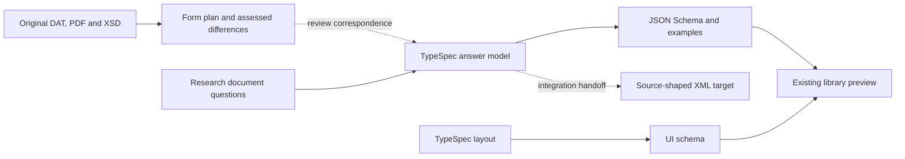
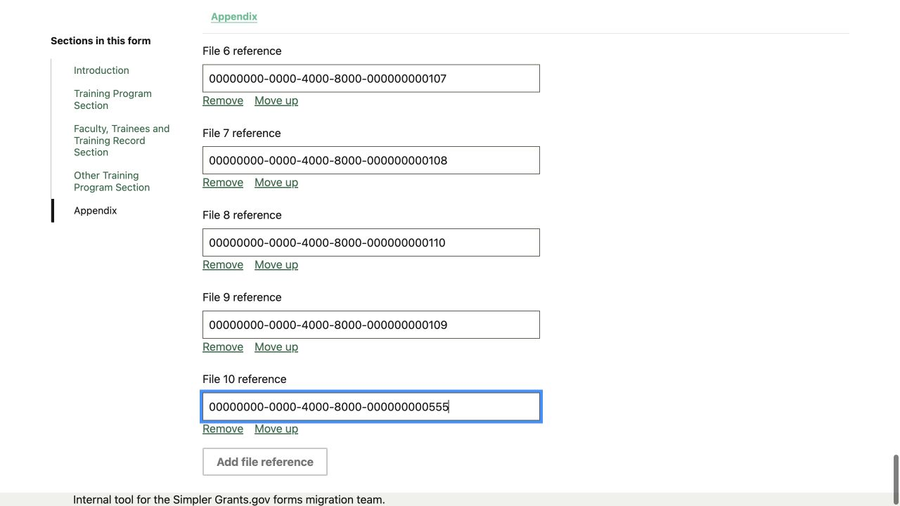

# PHS research document definitions

This adds PHS 398 Research Plan (FID 797, version 5.0) and PHS 398 Research Training Program Plan (FID 798, version 5.0). Start with each form’s **Field tree**, compare its Appendix with the DAT/XSD, then open **Form preview** and **Data**.

The definition boundary is plans, questions, TypeSpec models/layouts, generated schema/UI and illustrative answers. The preview edits file references using the existing library registry. It does not upload files, evaluate other forms, or export attachment XML.

## Answer shape and reuse

The form root is a collection of named document purposes. Each singleton value is an attachment UUID; Appendix is an ordered UUID list. UI headings do not create answer objects. Source `attFile` and collection wrappers belong to the XML target, not applicant JSON. One file containing several letters or faculty biographies remains one answer.

Seven questions have demonstrated consumers in both forms: Introduction to Application, Multiple PD/PI Leadership Plan, Vertebrate Animals, Select Agent Research, Consortium/Contractual Arrangements, Letters of Support, and Other Plans. They extend the existing attachment scalar. Each form retains exact source labels/help at its use site; shared question identity does not imply shared applicant answers or automatic population.

The training Program Plan and research Research Strategy are different purposes. Training Progress Report is not Research Progress Report Publication List. Participating Faculty Biosketches is a combined training-faculty document, not a single senior/key person’s Biographical Sketch or the existing overflow-biographies question. These remain local named fields until matching consumers justify new bank questions.

| Form                      | Named single-file fields | Appendix                 | Always required   |
| ------------------------- | -----------------------: | ------------------------ | ----------------- |
| Research Plan 797         |                       12 | Optional, up to 10 UUIDs | Research Strategy |
| Training Program Plan 798 |                       13 | Optional, up to 10 UUIDs | Program Plan      |

## Source obligations retained for integration

| Source                                   | Requirement                                                                                                                       | Definition/preview boundary                                                                                                                                                                       |
| ---------------------------------------- | --------------------------------------------------------------------------------------------------------------------------------- | ------------------------------------------------------------------------------------------------------------------------------------------------------------------------------------------------- |
| Both DAT Q8; research K8 and training K8 | Introduction required for SF424 (R&R) Resubmission or Revision; research enables it only for those types                          | Exact guidance retained; external application type is not a new local answer. Training K8 provides Add/Delete/View for those types without an explicit otherwise rule. No clearing rule inferred. |
| Research Q12                             | Progress Report Publication List required for Renewal                                                                             | Guidance retained; no external-context execution claimed.                                                                                                                                         |
| Training K14, Q14                        | Progress Report enabled for Renewal/Resubmission; required for Renewal, optional for Resubmission; otherwise disabled and cleared | Exact transition obligation retained. A standalone UUID preview does not execute it.                                                                                                              |
| Research Q14; training Q20               | Vertebrate Animals required when R&R Other Project Information animals-used answer is Yes                                         | External binding and evaluation remain integration work.                                                                                                                                          |
| Research Q23; training K25/Q25           | At most 10 Appendix PDF files                                                                                                     | `maxItems(10)` is enforced locally. Raw XSD target remains 0–100; exact source-layer difference is recorded.                                                                                      |
| All document help                        | PDF format; applicable opportunity and agency instructions/page limits                                                            | UUID validation does not inspect file bytes. No numerical page limit is invented.                                                                                                                 |

The XML target preserves each exact root namespace, fixed FormVersion 5.0, required collection, named document/attFile wrappers and Appendix file order. FileName and MimeType are 1–255-character service-owned strings. FileLocation is required but its qualified att:href anyURI attribute is optional. HashValue contains base64Binary with a required qualified glob:hashAlgorithm attribute; the source does not select an algorithm. These are service-owned descriptor values. Attachment XML mapping is deliberately inactive until the shared integration can resolve those values and output the wrappers. No replacement mapper or invented descriptor is included.

Unknown application context must not be interpreted as New or animals-used No. Absence, an empty Appendix and duplicate ordered references remain distinct; the sources supply no uniqueness rule. Production handling must decide and test empty-wrapper behavior explicitly.

## Review and checks

Each form has minimum, all-purpose and ten-file examples in TypeSpec. “All purposes” demonstrates schema paths, not a claim that every purpose applies to one application. Synthetic UUIDs have no uploaded file behind them. The form-level source notes preserve OMB/burden information and the remaining integration obligations.

Use the existing parity suite for all original DAT/XSD leaves, identity, source-shaped targets, labels, order and scoped differences. Compiled-consumer tests check every example, missing/invalid required documents, optional omission, UUID versus descriptor/list errors, the 10/11 Appendix boundary, semantic question identities and native collection. The renderer regression retains the existing warning fallback and verifies editing updates warning inputs without remounting fields. The small shared warning/wrapping refinements also appear in the separate assurance preview work; this branch carries only those scoped changes on its document-definition base.

For an applicant-proxy walkthrough: start empty, enter distinct references, correct an invalid UUID, clear/recover the required document, add/reorder/remove Appendix references and edit a sibling without resetting. Inspect live Data for purpose and list order. Add ten references and confirm Add disables, remove one and confirm it re-enables. Load sample and Check are separate reset cases. Inspect a measured narrow viewport and section navigation. Attachment warnings are currently in the summary; the reference control has no inline error display. These are agent proxy checks, not human usability acceptance or production submission evidence.

Existing SGG equivalents were not found for either FID in the pinned literal-registration API inventory. That observation is repository-scoped, not a claim about production deployment. Registration, real uploads/ownership/content checks, application context, XML export, signing and submission remain separate work.

## Library reference preview

After a ten-reference training Appendix task: ordered values survive move/remove/add and sibling edits; Add disables at the DAT limit. References are synthetic.

