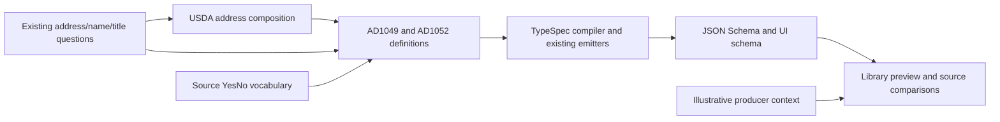
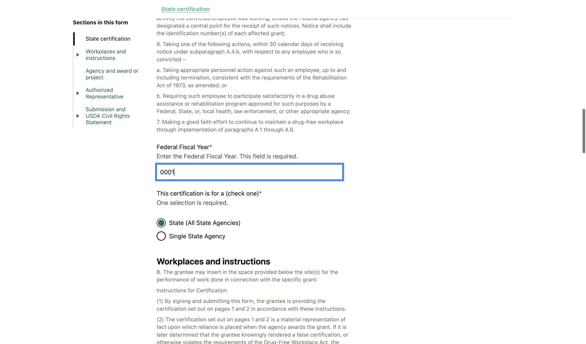

# USDA workplace certification definitions

AD1049 and AD1052 define the applicant answers, source plan, TypeSpec layout, examples and source-shaped XML targets for version 2.0. The library preview exercises those definitions with illustrative cover/submission context. Production population, authentic signing, XML generation and submission remain separate integration work.

## Review the differences

| Contract                            | AD1049                                                         | AD1052                                                    |
| ----------------------------------- | -------------------------------------------------------------- | --------------------------------------------------------- |
| Organization/agency                 | Organization name supplied by the application cover            | Agency name entered by the applicant                      |
| Fiscal year and certification scope | No invented equivalents                                        | Four-character YEAR text and the two source scope choices |
| Workplaces                          | Zero to ten locations; no location inferred from an empty form | Same source-qualified composition                         |
| Postal capture                      | Source maximum 30                                              | DAT maximum 10; original XSD maximum 30 remains explicit  |
| Representative/signature/date       | Required supplied context, readonly in the preview             | Same ownership boundary                                   |

The shared address composes existing bank parts and has no new question identity. These USDA XSDs place independently optional State and Province elements in a sequence. The DAT marks Province inactive for US addresses and State inactive for other countries, without instructing that retained values be cleared. The generic bank Address hides Province for US addresses. This pair therefore shares a small USDA activity composition without changing that bank question globally.

AD1052 keeps year `0001` as text and rejects `0000`, five characters and non-digits. This is the declared DAT four-character/XSD1.0 intersection. It does not claim to implement every signed, extended or timezone-qualified `xs:gYear` lexical form or an XML lowering strategy.

## Walk through the preview

1. Open either form and select **Form preview**. Start blank to distinguish applicant fields from missing producer context.
2. Load **Sample 1** for two contrasting US/Canadian workplaces; **Sample 2** is the minimum example. Sample ordering is the emitted ordering, shown by the sample selector.
3. Change a country and an unrelated project/agency answer. Confirm inactive State/Province values remain in **Data**, while the source-inactive control is disabled. AD1052 postal length 11 must fail and 10 must recover.
4. Delete the second location, then immediately **Check for errors**. The deleted location must stay deleted. Checkbox check/uncheck must produce source strings `Y: Yes` / `N: No`; an untouched optional answer remains absent.
5. Confirm supplied representative/signature/date values survive ordinary edits and remain readonly. Clear, then load the other sample to inspect the contrasting producer context.

Full source certification, instructions and civil-rights text remain available in the rendered form. The pinned sources state OMB expiration September 30, 2025 and revision 12/22. Those dates and the source wording are preserved; a current official successor edition and production metadata still need confirmation. Definition checks do not determine policy or legal acceptance.

## Shared preview support

Inherited readonly metadata reaches leaf controls. The native SGG collector is reused; the library adds explicitly loaded immutable context and reads retained values from current disabled controls. It never merges historical editable rows back into the answer. Each collapsible row evaluates the current country-field rules against that row's data, and list mutations publish their committed membership before validation. Field rules and labeled child-group rules are supported; rules on the detail root or unlabeled layouts remain outside this proof. The encoded Checkbox renderer is selected only for the exact source YesNo string domain. A generic nested enum-array consumer also checks the committed native collection seam through the stock MultiSelect, including Enter, pill removal and a dependent enable rule; it does not import another form. The encoded Checkbox selection covers JSON Forms controls; repeated-entry widgets that bypass that registry remain outside its proof. These are library-preview extensions, not application services or per-form runtime exceptions.

The source campaign exercised checkbox and row/country tasks with actual widgets, correction/recovery, immediate Check, keyboard navigation and a 375px viewport. The isolated package retains the matched tests; its deployed preview and browser verification remain separate checks. Shared-address extraction was checked against the prior AD1049 contract: complete fields, exact UI, readonly/country rules and source-boundary cases stay equal. Requested review, human acceptance and production integration are separate.

